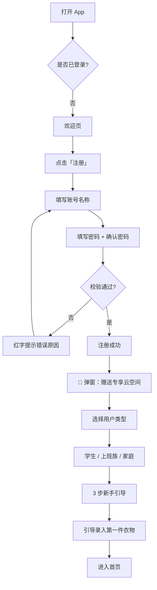
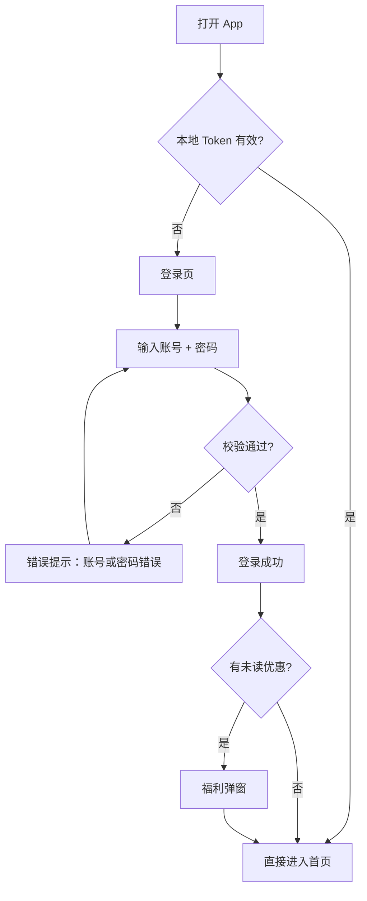
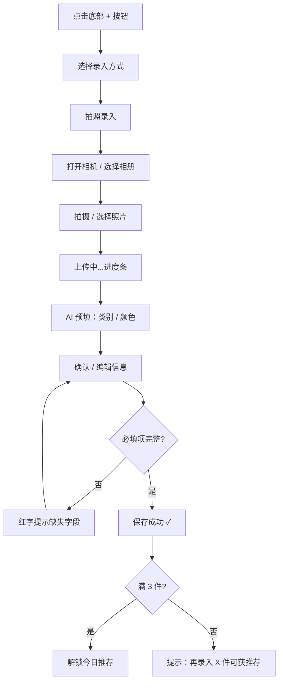
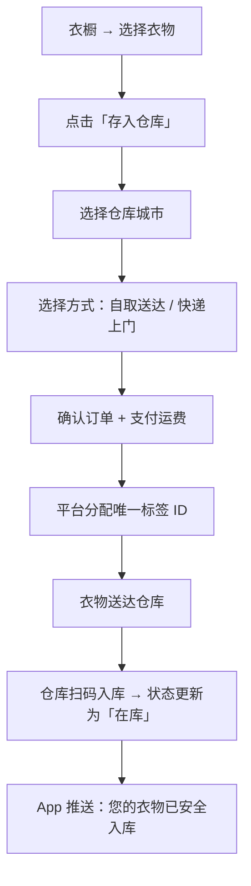
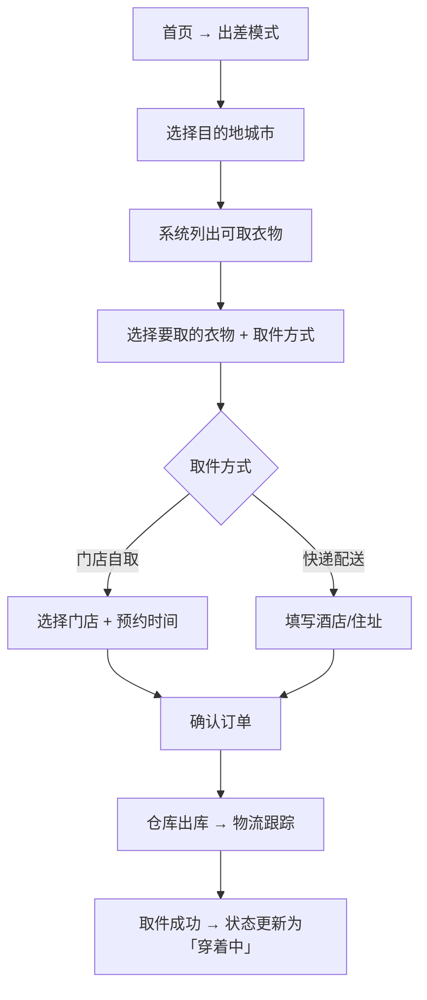

# 云衣柜 · 用户交互流程

**版本**：v1.0  
**关联文档**：[PRD](./01-PRD-产品设计说明书.md) | [技术架构](./03-技术架构方案.md)

---

## 一、全局导航结构

```
底部 Tab 栏
├── 首页（今日）      — 穿搭推荐 + 概览
├── 衣橱             — 衣物列表 / 分类 / 搜索
├── 录入（+）        — 拍照 / 手动添加（居中浮动按钮）
├── 记录             — 穿搭日历 / 统计
└── 我的             — 个人中心 / 设置 / 会员
```

---

## 二、注册与登录流程

### 2.1 首次使用（新用户注册）



#### 注册页字段

| 字段 | 规则 | 校验 |
|------|------|------|
| 账号名称 | 4–20 字符，字母/数字/中文 | 实时唯一性检查 |
| 密码 | 8–32 位，含字母 + 数字 | 强度指示条 |
| 确认密码 | 与密码一致 | 不一致红字提示 |

#### 新用户福利弹窗

```
┌─────────────────────────────────┐
│         🎉 欢迎加入云衣柜！       │
│                                 │
│   已为您开通专享云空间            │
│   可免费存储 50 件衣物            │
│                                 │
│   [ 开始录入第一件衣物 ]          │
│   [ 稍后再说 ]                   │
└─────────────────────────────────┘
```

### 2.2 已有账号登录



### 2.3 后期扩展：微信关联登录（V1.5）

```
登录页
├── 账号密码登录（默认）
└── 微信一键登录
    ├── 首次：授权 → 绑定手机号 → 创建账号
    └── 已有账号：授权 → 自动关联登录
```

---

## 三、首页交互流程

### 3.1 首页布局与交互

```
┌──────────────────────────────────────┐
│ ☀️ 北京 22°C 晴    [通知铃铛]        │
├──────────────────────────────────────┤
│                                      │
│  ┌──────────────────────────────┐    │
│  │  今日穿搭推荐                  │    │
│  │  [上衣图] [裤子图] [鞋图]       │    │
│  │  「清爽通勤风，适合今日天气」    │    │
│  │  [ 穿上这套 ✓ ]  [ 换一套 ↻ ] │    │
│  └──────────────────────────────┘    │
│                                      │
│  衣橱概览   52件 │ 本周穿搭 4次       │
│  ┌────┐ ┌────┐ ┌────┐ ┌────┐       │
│  │上衣│ │裤子│ │鞋子│ │外套│       │
│  │ 18 │ │ 12 │ │  8 │ │ 14 │       │
│  └────┘ └────┘ └────┘ └────┘       │
│                                      │
│  ⚠️ 提醒                             │
│  · 白色衬衫已 14 天未洗               │
│  · 冬装建议存入云仓库                 │
│                                      │
│  💡 时尚灵感                          │
│  · 2025 春夏流行色：薄荷绿...         │
│                                      │
└──────────────────────────────────────┘
```

### 3.2 今日推荐交互

| 用户操作 | 系统响应 |
|----------|----------|
| 点击「穿上这套」 | 记录今日穿搭 → 绿勾动画 → 更新记录页 |
| 点击「换一套」 | 重新生成推荐（最多 3 次/天免费） |
| 点击单件衣物 | 跳转衣物详情，可替换该单品 |
| 长按推荐卡片 | 分享穿搭图片（V1.0） |

---

## 四、衣物录入流程

### 4.1 拍照录入（主路径）



### 4.2 录入表单字段

| 字段 | 必填 | 默认值 |
|------|------|--------|
| 照片 | ✅ | 用户拍摄 |
| 名称 | ✅ | AI 生成，如「蓝色条纹衬衫」 |
| 类别 | ✅ | AI 识别：上衣 |
| 颜色 | 推荐填 | AI 提取主色 |
| 季节 | 可选 | 根据当前月份推荐 |
| 场合 | 可选 | 日常 |
| 品牌 | 可选 | — |
| 购买日期 | 可选 | — |

### 4.3 快速录入模式

适合批量录入场景：

```
拍照 → 自动保存（仅照片 + AI 类别） → 继续拍下一件
详细信息稍后可在衣橱列表中批量编辑
```

---

## 五、衣橱管理流程

### 5.1 衣橱列表

```
┌──────────────────────────────────────┐
│ 🔍 搜索衣物...                        │
│ [全部] [上衣] [裤子] [鞋子] [外套]     │
│ [春季] [夏季] [秋季] [冬季]            │
├──────────────────────────────────────┤
│ ┌────┐ 蓝色条纹衬衫                    │
│ │ 📷 │ 上衣 · 蓝 · 穿了 12 次          │
│ └────┘ 上次穿：3 天前                  │
├──────────────────────────────────────┤
│ ┌────┐ 黑色休闲裤                    │
│ │ 📷 │ 裤子 · 黑 · 穿了 8 次           │
│ └────┘ 上次穿：昨天                    │
└──────────────────────────────────────┘
```

### 5.2 衣物详情操作

| 操作 | 说明 |
|------|------|
| 编辑信息 | 修改名称、类别、标签 |
| 标记状态 | 待清洗 / 待维修 / 待捐赠 |
| 存入仓库 | 发起 O2O 入库（V2.0） |
| 捐赠 | 发起捐赠申请 |
| 折旧置换 | 查看估值 + 申请置换（V1.0） |
| 删除 | 二次确认后删除 |

---

## 六、穿搭记录流程

### 6.1 记录页

```
┌──────────────────────────────────────┐
│  2025 年 6 月                         │
│  一  二  三  四  五  六  日            │
│      1   2   3   4   5   6            │
│      ✓   ✓       ✓   ✓               │
│  7   8   9  10  11  12  13            │
│                                      │
│  本周穿搭 4 次 │ 本月 18 次            │
│  最常穿：蓝色条纹衬衫（12 次）          │
│  闲置：灰色西装外套（90 天未穿）        │
└──────────────────────────────────────┘
```

### 6.2 打卡方式

1. **主动打卡**：首页推荐 → 「穿上这套」
2. **手动补录**：记录页 → 选择日期 → 选择衣物组合
3. **自动建议**：每晚 8 点推送「今天穿的是什么？」

---

## 七、O2O 场景交互流程（V2.0）

### 7.1 衣物入库（存入云仓库）



### 7.2 异地取衣



### 7.3 门店换衣体验

```
用户到达门店
  → 出示 App 二维码
  → 交出需洗护的旧衣
  → 店员扫码确认
  → 系统推送已整理好的搭配到 App
  → 用户更衣室换衣
  → 确认穿搭 → 出门

后台：旧衣 → 洗护流程 → 入库
      新衣 → 出库 → 穿着中
```

### 7.4 唯一标签体系

每件衣物入库时：

```
CloudWardrobe-2025-00000142
├── RFID 标签（物理附着）
├── 二维码（可扫描）
└── App 内数字 ID（关联用户衣橱记录）
```

支持操作：入库 / 出库 / 洗护中 / 在穿 / 已捐赠

---

## 八、捐赠与折旧流程

### 8.1 捐赠

```
选择衣物 → 标记「待捐赠」 → 选择接收机构
→ 生成捐赠清单 PDF → 选择寄送方式
→ 确认捐赠 → 衣物状态变为「已捐赠」→ 获得捐赠证书
```

### 8.2 折旧置换

```
选择衣物 → 查看系统估值（基于年限 + 磨损 + 品牌）
→ 接受估值 / 重新评估 → 选择置换方式
→ 抵扣会员费 / 抵扣取衣服务费 / 捐赠
```

---

## 九、个人中心

```
我的
├── 个人信息（头像可点击上传 / 昵称 / 用户类型）
│   ├── 从相册选择（支持裁剪）
│   ├── 拍照（移动端）
│   └── 移除当前头像
├── 云空间卡片（点击 → /profile/cloud-storage）
├── 会员中心（/profile/membership）
│   ├── 积分进度与等级
│   ├── 权益列表
│   └── 积分兑换
├── 我的订单（/profile/orders）
│   ├── 筛选：全部 / 仓储 / 取衣 / 保养
│   ├── 订单详情弹窗
│   └── 取消订单（进行中状态）
├── 意见反馈（/profile/feedback）
│   ├── 类型选择
│   ├── 内容 + 联系方式
│   └── 截图附件（模拟）
├── 设置（/profile/settings）
│   ├── 通知开关
│   ├── 隐私开关
│   └── 深色模式
└── 退出登录
```

### 9.1 登录密码可见切换

- 登录页 / 注册页密码框右侧显示眼睛图标
- 点击切换明文/密文显示，便于用户确认输入是否正确

---

## 十、异常与边界处理

| 场景 | 处理方式 |
|------|----------|
| 网络断开时录入 | 本地缓存，恢复网络后自动同步 |
| 云空间已满 | 弹窗提示扩容 / 删除旧衣 / 存入仓库 |
| 推荐衣物不足 3 件 | 提示「再录入 X 件解锁智能推荐」 |
| 衣物在仓库中时 | 详情页显示「在库 · 上海仓」，不可标记穿着 |
| 登录过期 | 静默刷新 Token，失败则跳转登录页 |
| 重复注册 | 提示「该账号已存在，是否直接登录？」 |
