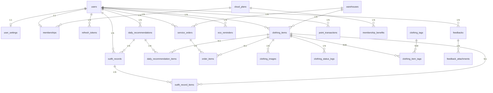
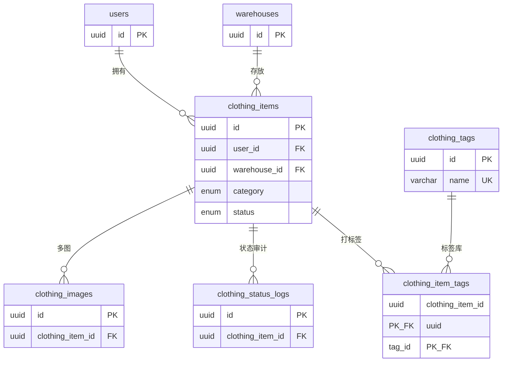
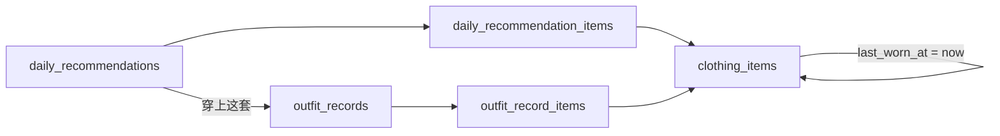
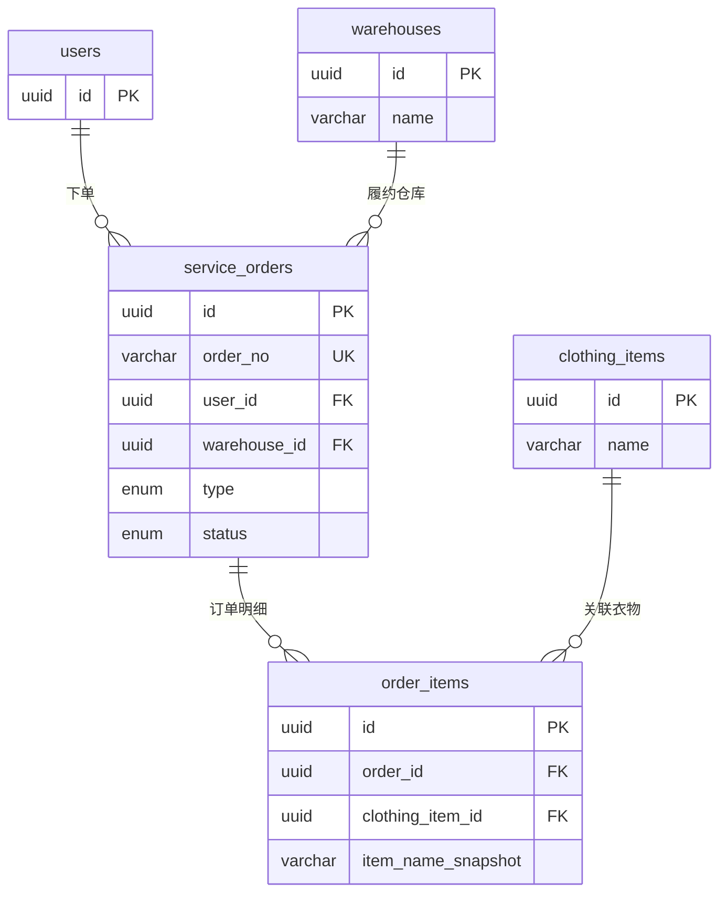
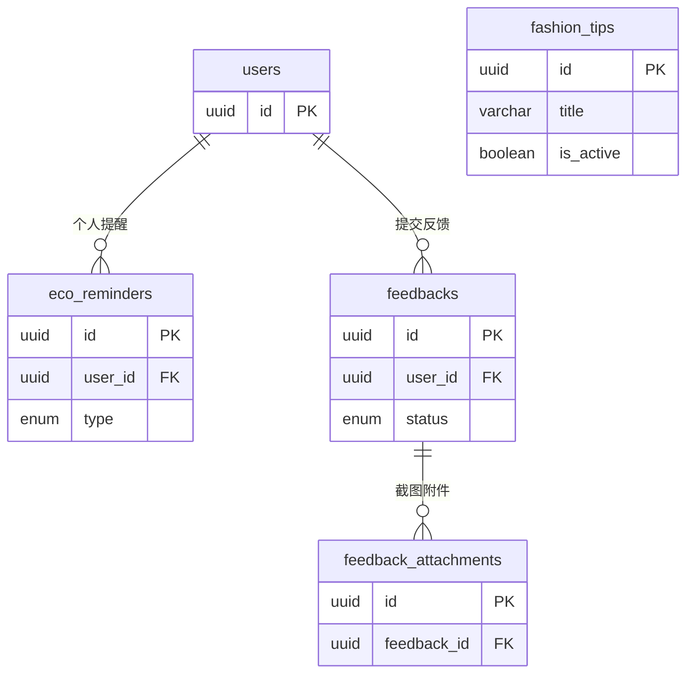

# 云衣柜 · 数据库设计方案

**版本**：v1.0  
**数据库**：PostgreSQL 16  
**ORM**：Prisma  
**后端项目**：CloudWardrobe  
**对齐分支**：`cursor/ui-interactive-prototype-6952`（UI 原型）  
**代码位置**：`services/CloudWardrobe/prisma/`

---

## 一、设计目标

本方案以 UI 交互原型中的 **Zustand 状态 + Mock 数据** 为输入，将前端已读写的字段映射为可持久化的关系型表结构，并与 [03-技术架构方案.md](./03-技术架构方案.md) 中的 NestJS + Prisma + PostgreSQL 技术栈保持一致。

### 设计原则

| 原则 | 说明 |
|------|------|
| UI 字段一一映射 | 原型中每个被读写的字段都有对应列，或可由查询推导 |
| 存储事实，计算展示 | `lastWornDaysAgo`、`cloudUsed`、分类统计等由 API 层计算 |
| 多租户隔离 | 所有业务表带 `user_id`，按用户行级隔离 |
| 软删除 | 用户、衣物使用 `deleted_at`，支持账号注销冷静期 |
| 枚举规范化 | category、status、order_type 等使用 PostgreSQL ENUM |

---

## 二、技术栈与目录

| 项目 | 选型 |
|------|------|
| 关系数据库 | PostgreSQL 16 |
| ORM | Prisma 6.x |
| 缓存 | Redis 7（JWT 黑名单、推荐缓存、天气） |
| 对象存储 | OSS（衣物图片、反馈截图） |
| 模糊搜索 | `pg_trgm` 扩展（MVP） |

```
services/CloudWardrobe/
├── prisma/
│   ├── schema.prisma                          # 数据模型定义
│   ├── seed.ts                                # 种子数据
│   └── migrations/
│       └── 20250614000000_init/
│           └── migration.sql                  # 初始迁移脚本
├── package.json
└── .env.example
```

### 本地初始化

```bash
cd services/CloudWardrobe
cp .env.example .env
npm install
npm run db:migrate    # prisma migrate deploy
npm run db:seed       # 写入套餐 / 权益 / 资讯
npm run db:generate   # 生成 Prisma Client
```

---

## 三、表关系图

### 3.1 全局关系总览

以 `users` 为中心，所有业务数据按 `user_id` 隔离；`clothing_items` 为衣橱核心，串联推荐、打卡与订单。



---

### 3.2 全局 ER 图（含主键 / 外键）

```mermaid
erDiagram
    users {
        uuid id PK
        varchar username UK
        varchar password_hash
        enum user_type
        int cloud_quota
        timestamptz onboarding_completed_at
        timestamptz deleted_at
    }

    user_settings {
        uuid user_id PK_FK
        boolean notify_outfit
        boolean dark_mode
    }

    refresh_tokens {
        uuid id PK
        uuid user_id FK
        varchar token_hash
        timestamptz expires_at
    }

    cloud_plans {
        varchar id PK
        int quota
        int price_cents
    }

    memberships {
        uuid user_id PK_FK
        varchar plan_id FK
        int points
    }

    point_transactions {
        uuid id PK
        uuid user_id FK
        int amount
        int balance_after
    }

    membership_benefits {
        uuid id PK
        varchar plan_id FK
        varchar title
    }

    clothing_items {
        uuid id PK
        uuid user_id FK
        uuid warehouse_id FK
        varchar name
        enum category
        enum status
        int wear_count
        timestamptz last_worn_at
        timestamptz deleted_at
    }

    clothing_images {
        uuid id PK
        uuid clothing_item_id FK
        text url
    }

    clothing_tags {
        uuid id PK
        varchar name UK
    }

    clothing_item_tags {
        uuid clothing_item_id PK_FK
        uuid tag_id PK_FK
    }

    clothing_status_logs {
        uuid id PK
        uuid clothing_item_id FK
        enum from_status
        enum to_status
    }

    daily_recommendations {
        uuid id PK
        uuid user_id FK
        date recommend_date
        int sequence
        boolean is_confirmed
    }

    daily_recommendation_items {
        uuid recommendation_id PK_FK
        uuid clothing_item_id FK
        enum slot PK
    }

    outfit_records {
        uuid id PK
        uuid user_id FK
        uuid recommendation_id FK
        date outfit_date UK
    }

    outfit_record_items {
        uuid outfit_record_id PK_FK
        uuid clothing_item_id FK
        enum slot PK
    }

    warehouses {
        uuid id PK
        varchar name
        varchar city
    }

    service_orders {
        uuid id PK
        varchar order_no UK
        uuid user_id FK
        uuid warehouse_id FK
        enum type
        enum status
    }

    order_items {
        uuid id PK
        uuid order_id FK
        uuid clothing_item_id FK
        varchar item_name_snapshot
    }

    eco_reminders {
        uuid id PK
        uuid user_id FK
        enum type
        boolean is_read
    }

    fashion_tips {
        uuid id PK
        varchar title
        boolean is_active
    }

    feedbacks {
        uuid id PK
        uuid user_id FK
        varchar category
        enum status
    }

    feedback_attachments {
        uuid id PK
        uuid feedback_id FK
        text url
    }

    users ||--o| user_settings : user_id
    users ||--o| memberships : user_id
    users ||--o{ refresh_tokens : user_id
    users ||--o{ point_transactions : user_id
    users ||--o{ clothing_items : user_id
    users ||--o{ daily_recommendations : user_id
    users ||--o{ outfit_records : user_id
    users ||--o{ service_orders : user_id
    users ||--o{ eco_reminders : user_id
    users ||--o{ feedbacks : user_id

    cloud_plans ||--o{ memberships : plan_id
    cloud_plans ||--o{ membership_benefits : plan_id

    clothing_items ||--o{ clothing_images : clothing_item_id
    clothing_items ||--o{ clothing_status_logs : clothing_item_id
    clothing_items ||--o{ clothing_item_tags : clothing_item_id
    clothing_tags ||--o{ clothing_item_tags : tag_id
    warehouses ||--o{ clothing_items : warehouse_id

    daily_recommendations ||--o{ daily_recommendation_items : recommendation_id
    clothing_items ||--o{ daily_recommendation_items : clothing_item_id
    daily_recommendations ||--o{ outfit_records : recommendation_id
    outfit_records ||--o{ outfit_record_items : outfit_record_id
    clothing_items ||--o{ outfit_record_items : clothing_item_id

    warehouses ||--o{ service_orders : warehouse_id
    service_orders ||--o{ order_items : order_id
    clothing_items ||--o{ order_items : clothing_item_id

    feedbacks ||--o{ feedback_attachments : feedback_id
```

---

### 3.3 按业务模块分组

#### 3.3.1 用户与认证

```mermaid
erDiagram
    users ||--o| user_settings : "注册后创建"
    users ||--o| memberships : "注册后创建"
    users ||--o{ refresh_tokens : "登录签发"
    users ||--o{ point_transactions : "积分变动"
    cloud_plans ||--o{ memberships : "套餐绑定"
    cloud_plans ||--o{ membership_benefits : "权益配置"

    users {
        uuid id PK
        varchar username UK
        enum user_type
        int cloud_quota
    }
    user_settings {
        uuid user_id PK_FK
    }
    memberships {
        uuid user_id PK_FK
        varchar plan_id FK
        int points
    }
    refresh_tokens {
        uuid id PK
        uuid user_id FK
    }
    cloud_plans {
        varchar id PK
        int quota
    }
    point_transactions {
        uuid id PK
        uuid user_id FK
    }
```

#### 3.3.2 衣橱



#### 3.3.3 穿搭推荐与打卡

```mermaid
erDiagram
    users ||--o{ daily_recommendations : "每日推荐"
    daily_recommendations ||--o{ daily_recommendation_items : "组合衣物"
    clothing_items ||--o{ daily_recommendation_items : "被推荐"

    users ||--o{ outfit_records : "打卡记录"
    daily_recommendations ||--o| outfit_records : "确认后关联"
    outfit_records ||--o{ outfit_record_items : "当日穿着"
    clothing_items ||--o{ outfit_record_items : "被穿着"

    daily_recommendations {
        uuid id PK
        uuid user_id FK
        date recommend_date
        int sequence
        boolean is_confirmed
    }
    daily_recommendation_items {
        uuid recommendation_id PK_FK
        enum slot PK
        uuid clothing_item_id FK
    }
    outfit_records {
        uuid id PK
        uuid user_id FK
        uuid recommendation_id FK
        date outfit_date
    }
    outfit_record_items {
        uuid outfit_record_id PK_FK
        enum slot PK
        uuid clothing_item_id FK
    }
    clothing_items {
        uuid id PK
        int wear_count
        timestamptz last_worn_at
    }
```

**打卡数据流**：



#### 3.3.4 服务订单



#### 3.3.5 内容与反馈



> `fashion_tips`、`membership_benefits`、`cloud_plans` 为全局配置表，不直接关联 `users`。

---

### 3.4 外键关系一览

| 子表 | 外键列 | 父表 | 父表主键 | 删除策略 | 说明 |
|------|--------|------|----------|----------|------|
| `user_settings` | `user_id` | `users` | `id` | CASCADE | 删用户同步删设置 |
| `refresh_tokens` | `user_id` | `users` | `id` | CASCADE | 登出可单独 revoke |
| `memberships` | `user_id` | `users` | `id` | CASCADE | 1:1 会员 |
| `memberships` | `plan_id` | `cloud_plans` | `id` | RESTRICT | 套餐不可随意删 |
| `point_transactions` | `user_id` | `users` | `id` | CASCADE | 积分流水 |
| `membership_benefits` | `plan_id` | `cloud_plans` | `id` | SET NULL | 套餐下架保留文案 |
| `clothing_items` | `user_id` | `users` | `id` | CASCADE | 衣橱归属 |
| `clothing_items` | `warehouse_id` | `warehouses` | `id` | SET NULL | 衣物出仓 |
| `clothing_images` | `clothing_item_id` | `clothing_items` | `id` | CASCADE | 衣物多图 |
| `clothing_item_tags` | `clothing_item_id` | `clothing_items` | `id` | CASCADE | 标签关联 |
| `clothing_item_tags` | `tag_id` | `clothing_tags` | `id` | CASCADE | 标签关联 |
| `clothing_status_logs` | `clothing_item_id` | `clothing_items` | `id` | CASCADE | 状态审计 |
| `daily_recommendations` | `user_id` | `users` | `id` | CASCADE | 每日推荐 |
| `daily_recommendation_items` | `recommendation_id` | `daily_recommendations` | `id` | CASCADE | 推荐组合 |
| `daily_recommendation_items` | `clothing_item_id` | `clothing_items` | `id` | CASCADE | 推荐衣物 |
| `outfit_records` | `user_id` | `users` | `id` | CASCADE | 打卡记录 |
| `outfit_records` | `recommendation_id` | `daily_recommendations` | `id` | SET NULL | 推荐删除保留打卡 |
| `outfit_record_items` | `outfit_record_id` | `outfit_records` | `id` | CASCADE | 穿着明细 |
| `outfit_record_items` | `clothing_item_id` | `clothing_items` | `id` | CASCADE | 穿着衣物 |
| `service_orders` | `user_id` | `users` | `id` | CASCADE | 服务订单 |
| `service_orders` | `warehouse_id` | `warehouses` | `id` | SET NULL | 仓库变更 |
| `order_items` | `order_id` | `service_orders` | `id` | CASCADE | 订单明细 |
| `order_items` | `clothing_item_id` | `clothing_items` | `id` | SET NULL | 衣物删除保留快照名 |
| `eco_reminders` | `user_id` | `users` | `id` | CASCADE | 环保提醒 |
| `feedbacks` | `user_id` | `users` | `id` | SET NULL | 用户注销保留反馈 |
| `feedback_attachments` | `feedback_id` | `feedbacks` | `id` | CASCADE | 反馈附件 |

---

### 3.5 关系基数速查

| 关系 | 基数 | 联合主键 / 唯一约束 |
|------|------|---------------------|
| users ↔ user_settings | 1 : 1 | `user_settings.user_id` |
| users ↔ memberships | 1 : 1 | `memberships.user_id` |
| users ↔ refresh_tokens | 1 : N | — |
| users ↔ clothing_items | 1 : N | — |
| users ↔ daily_recommendations | 1 : N | `(user_id, recommend_date, sequence)` 唯一 |
| users ↔ outfit_records | 1 : N | `(user_id, outfit_date)` 唯一 |
| users ↔ service_orders | 1 : N | `order_no` 唯一 |
| users ↔ eco_reminders | 1 : N | — |
| users ↔ feedbacks | 1 : N | `user_id` 可空 |
| users ↔ point_transactions | 1 : N | — |
| cloud_plans ↔ memberships | 1 : N | — |
| cloud_plans ↔ membership_benefits | 1 : N | — |
| clothing_items ↔ clothing_images | 1 : N | — |
| clothing_items ↔ clothing_status_logs | 1 : N | — |
| clothing_items ↔ clothing_tags | N : M | `clothing_item_tags` 联合主键 |
| clothing_items ↔ daily_recommendation_items | 1 : N | `(recommendation_id, slot)` 联合主键 |
| clothing_items ↔ outfit_record_items | 1 : N | `(outfit_record_id, slot)` 联合主键 |
| clothing_items ↔ order_items | 1 : N | — |
| daily_recommendations ↔ outfit_records | 1 : N | 推荐确认后关联 |
| daily_recommendations ↔ daily_recommendation_items | 1 : N | — |
| outfit_records ↔ outfit_record_items | 1 : N | — |
| service_orders ↔ order_items | 1 : N | — |
| warehouses ↔ clothing_items | 1 : N | — |
| warehouses ↔ service_orders | 1 : N | — |
| feedbacks ↔ feedback_attachments | 1 : N | — |

---

### 3.6 核心链路示意（ASCII）

```
users
 ├── user_settings          (1:1)
 ├── memberships ──────────► cloud_plans
 │                           membership_benefits
 ├── refresh_tokens         (1:N)
 ├── point_transactions     (1:N)
 ├── clothing_items ◄────── warehouses
 │    ├── clothing_images
 │    ├── clothing_status_logs
 │    ├── clothing_item_tags ──► clothing_tags
 │    ├── daily_recommendation_items ◄── daily_recommendations
 │    ├── outfit_record_items ◄──────── outfit_records
 │    └── order_items ◄──────────────── service_orders
 ├── daily_recommendations
 │    └── outfit_records (确认打卡后关联)
 ├── outfit_records
 ├── service_orders ─────────► warehouses
 ├── eco_reminders
 └── feedbacks
      └── feedback_attachments

独立配置表（无 user_id）：
  cloud_plans · membership_benefits · fashion_tips
```


## 四、枚举类型

| 枚举名 | 值 | 用途 |
|--------|-----|------|
| `UserType` | `student`, `worker`, `family` | 用户画像（引导页） |
| `ClothingCategory` | `top`, `bottom`, `shoes`, `outerwear`, `accessory` | 衣物分类 |
| `ClothingStatus` | `normal`, `washing`, `in_storage`, `repair`, `donate`, `wearing`, `donated`, `disposed` | 衣物生命周期 |
| `OutfitSlot` | `top`, `bottom`, `shoes`, `outerwear`, `accessory` | 穿搭槽位 |
| `OrderType` | `storage`, `pickup`, `care` | 仓储 / 取衣 / 保养 |
| `OrderStatus` | `pending`, `processing`, `shipping`, `completed`, `cancelled` | 订单状态 |
| `ReminderType` | `warning`, `info` | 环保提醒 |
| `FeedbackStatus` | `open`, `in_progress`, `resolved`, `closed` | 反馈工单 |
| `StatusLogOperator` | `user`, `system`, `warehouse` | 状态变更操作方 |

### 衣物状态机

```
normal（正常）
  → washing（待清洗）
  → repair（待维修）
  → donate（待捐赠）
  → in_storage（在库）
  → wearing（穿着中）
  → donated（已捐赠）
  → disposed（已处置）
```

原型阶段 UI 仅使用 `normal` / `washing` / `in_storage`，其余状态为 Phase 2 预留。

---

## 五、表结构明细

### 5.1 用户与认证

#### `users` — 用户主表

| 列名 | 类型 | 约束 | UI / 原型映射 |
|------|------|------|---------------|
| `id` | UUID | PK | — |
| `username` | VARCHAR(64) | UNIQUE, NOT NULL | `username` |
| `password_hash` | VARCHAR(255) | NOT NULL | 登录/注册（UI 校验，未存原型） |
| `email` | VARCHAR(255) | UNIQUE, NULL | 后续扩展 |
| `phone` | VARCHAR(20) | UNIQUE, NULL | 后续扩展 |
| `user_type` | UserType | NULL | `student \| worker \| family` |
| `avatar_url` | TEXT | NULL | `avatarUri` → OSS URL |
| `cloud_quota` | INT | DEFAULT 50 | `cloudQuota`（注册赠 50 件） |
| `onboarding_completed_at` | TIMESTAMPTZ | NULL | `hasCompletedOnboarding` |
| `created_at` | TIMESTAMPTZ | NOT NULL | — |
| `updated_at` | TIMESTAMPTZ | NOT NULL | — |
| `deleted_at` | TIMESTAMPTZ | NULL | 账号注销冷静期 |

**索引**：`username`（唯一）、`email`、`phone`、`user_type`、`deleted_at`

---

#### `user_settings` — 用户设置（1:1）

| 列名 | 类型 | 默认 | UI 映射 |
|------|------|------|---------|
| `user_id` | UUID | PK, FK | — |
| `notify_outfit` | BOOLEAN | true | `notifyOutfit` |
| `notify_promo` | BOOLEAN | true | `notifyPromo` |
| `notify_order` | BOOLEAN | true | `notifyOrder` |
| `dark_mode` | BOOLEAN | false | `darkMode` |
| `privacy_share` | BOOLEAN | false | `privacyShare` |
| `updated_at` | TIMESTAMPTZ | — | — |

---

#### `refresh_tokens` — JWT 刷新令牌

| 列名 | 类型 | 说明 |
|------|------|------|
| `id` | UUID | PK |
| `user_id` | UUID | FK → users |
| `token_hash` | VARCHAR(255) | 哈希存储 |
| `expires_at` | TIMESTAMPTZ | 过期时间 |
| `revoked_at` | TIMESTAMPTZ | 登出时撤销 |
| `created_at` | TIMESTAMPTZ | — |

---

### 5.2 会员与云空间

#### `cloud_plans` — 云空间套餐（配置表）

| 列名 | 类型 | 种子数据 |
|------|------|----------|
| `id` | VARCHAR(32) | `free` / `standard` / `premium` |
| `name` | VARCHAR(64) | 免费版 / 标准版 / 尊享版 |
| `quota` | INT | 50 / 100 / 200 |
| `price_cents` | INT | 0 / 1500 / 3900 |
| `description` | TEXT | 套餐描述 |
| `is_active` | BOOLEAN | 是否可购 |
| `sort_order` | INT | 排序 |

---

#### `memberships` — 用户会员（1:1）

| 列名 | 类型 | UI 映射 |
|------|------|---------|
| `user_id` | UUID | PK, FK |
| `plan_id` | VARCHAR(32) | `membershipLevel` |
| `points` | INT | `points`（默认 0） |
| `expires_at` | TIMESTAMPTZ | NULL = 免费永不过期 |
| `updated_at` | TIMESTAMPTZ | — |

---

#### `point_transactions` — 积分流水

| 列名 | 类型 | 说明 |
|------|------|------|
| `id` | UUID | PK |
| `user_id` | UUID | FK |
| `amount` | INT | 正数赚取 / 负数消费 |
| `balance_after` | INT | 变更后余额 |
| `reason` | VARCHAR(64) | `redeem_quota` / `daily_checkin` 等 |
| `created_at` | TIMESTAMPTZ | — |

---

#### `membership_benefits` — 会员权益文案（CMS）

| 列名 | 类型 | 说明 |
|------|------|------|
| `id` | UUID | PK |
| `plan_id` | VARCHAR(32) | 适用套餐，NULL = 全套餐 |
| `icon` | VARCHAR(8) | 如 ☁️ |
| `title` | VARCHAR(64) | 权益标题 |
| `description` | TEXT | 权益描述 |
| `sort_order` | INT | 排序 |
| `is_active` | BOOLEAN | 是否展示 |

---

### 5.3 衣橱（核心）

#### `clothing_items` — 衣物主表

| 列名 | 类型 | 约束 | UI 映射 |
|------|------|------|---------|
| `id` | UUID | PK | `id` |
| `user_id` | UUID | FK, NOT NULL | 衣橱归属 |
| `name` | VARCHAR(128) | NOT NULL | `name` |
| `category` | ClothingCategory | NOT NULL | `top/bottom/shoes/outerwear/accessory` |
| `color_name` | VARCHAR(32) | NOT NULL | `color` |
| `color_hex` | CHAR(7) | NOT NULL | `colorHex` |
| `season` | VARCHAR(16) | DEFAULT '四季' | `season` |
| `occasion` | VARCHAR(16) | DEFAULT '日常' | `occasion` |
| `status` | ClothingStatus | DEFAULT normal | `status` |
| `wear_count` | INT | DEFAULT 0 | `wearCount` |
| `last_worn_at` | TIMESTAMPTZ | NULL | 由 `lastWornDaysAgo` 反推 |
| `thumbnail_url` | TEXT | NULL | 原型 `emoji` 的正式替代 |
| `image_url` | TEXT | NULL | 拍照录入原图 |
| `brand` | VARCHAR(64) | NULL | Phase 2 |
| `purchase_date` | DATE | NULL | Phase 2 |
| `price_cents` | INT | NULL | Phase 2 |
| `unique_label_id` | VARCHAR(64) | NULL | O2O 仓储标签 Phase 2 |
| `warehouse_id` | UUID | FK, NULL | 所在仓库 |
| `created_at` | TIMESTAMPTZ | NOT NULL | — |
| `updated_at` | TIMESTAMPTZ | NOT NULL | — |
| `deleted_at` | TIMESTAMPTZ | NULL | 软删除 |

**索引**：
- `(user_id, deleted_at)` — 衣橱列表
- `(user_id, category)` — 分类筛选
- `(user_id, status)` — 云仓 / 清洗状态
- `(user_id, wear_count DESC)` — 穿着排行
- `(last_worn_at)` — 闲置检测
- GIN `name gin_trgm_ops` — 名称模糊搜索

**API 计算字段**（不入库）：

```typescript
// lastWornDaysAgo
lastWornDaysAgo = last_worn_at
  ? Math.floor((Date.now() - last_worn_at) / 86400000)
  : -1;

// cloudUsed
cloudUsed = COUNT(clothing_items WHERE user_id = ? AND deleted_at IS NULL)
```

---

#### `clothing_images` — 衣物多图

| 列名 | 类型 | 说明 |
|------|------|------|
| `id` | UUID | PK |
| `clothing_item_id` | UUID | FK |
| `url` | TEXT | OSS 地址 |
| `sort_order` | INT | 排序 |
| `created_at` | TIMESTAMPTZ | — |

---

#### `clothing_tags` + `clothing_item_tags` — 标签（多对多）

| 表 | 说明 |
|----|------|
| `clothing_tags` | `id`, `name`（唯一） |
| `clothing_item_tags` | `(clothing_item_id, tag_id)` 联合主键 |

原型未实现标签筛选，表结构为 Phase 1 预留。

---

#### `clothing_status_logs` — 状态变更审计

支撑详情页「标记待清洗 / 存入云仓库 / 发起捐赠」：

| 列名 | 类型 |
|------|------|
| `id` | UUID |
| `clothing_item_id` | UUID |
| `from_status` | ClothingStatus |
| `to_status` | ClothingStatus |
| `operator` | StatusLogOperator |
| `note` | TEXT |
| `created_at` | TIMESTAMPTZ |

---

### 5.4 穿搭推荐与记录

#### `daily_recommendations` — 今日推荐

对应 `outfitPresets` + `todayOutfitIndex` + `refreshOutfit`：

| 列名 | 类型 | UI 映射 |
|------|------|---------|
| `id` | UUID | PK |
| `user_id` | UUID | FK |
| `recommend_date` | DATE | 当天 |
| `sequence` | INT | 第几套（换一套 +1） |
| `title` | VARCHAR(64) | `清爽通勤风` |
| `description` | TEXT | 推荐文案 |
| `weather_snapshot` | JSONB | `{ city, temp, condition }` |
| `is_confirmed` | BOOLEAN | `todayOutfitConfirmed` |
| `confirmed_at` | TIMESTAMPTZ | 穿上这套时间 |
| `created_at` | TIMESTAMPTZ | — |

**唯一约束**：`(user_id, recommend_date, sequence)`

---

#### `daily_recommendation_items` — 推荐衣物组合

对应 `OutfitPreset.clothingIds: [top, bottom, shoes]`：

| 列名 | 类型 |
|------|------|
| `recommendation_id` | UUID |
| `clothing_item_id` | UUID |
| `slot` | OutfitSlot |

**主键**：`(recommendation_id, slot)`

---

#### `outfit_records` — 穿搭打卡记录

替代原型中 `outfitDays: number[]`（仅存当月日期数字）：

| 列名 | 类型 | 说明 |
|------|------|------|
| `id` | UUID | PK |
| `user_id` | UUID | FK |
| `outfit_date` | DATE | 完整日期，支撑日历 |
| `recommendation_id` | UUID | FK, NULL，来自推荐时关联 |
| `title` | VARCHAR(64) | 冗余快照 |
| `notes` | TEXT | 用户备注 Phase 2 |
| `created_at` | TIMESTAMPTZ | — |

**唯一约束**：`(user_id, outfit_date)` — 每天最多打卡一次

---

#### `outfit_record_items` — 当日穿着衣物

| 列名 | 类型 |
|------|------|
| `outfit_record_id` | UUID |
| `clothing_item_id` | UUID |
| `slot` | OutfitSlot |

**主键**：`(outfit_record_id, slot)`

**打卡事务**（对齐 `confirmOutfit` 逻辑）：

1. 插入 `outfit_records` + `outfit_record_items`
2. 对应 `clothing_items.wear_count += 1`，`last_worn_at = NOW()`
3. 更新 `daily_recommendations.is_confirmed = true`

---

#### 统计查询对照

| UI 展示（`records.tsx` / 首页） | 查询思路 |
|--------------------------------|----------|
| 日历打点 | `SELECT outfit_date FROM outfit_records WHERE user_id = ? AND outfit_date BETWEEN ? AND ?` |
| 穿着 TOP 3 | `ORDER BY wear_count DESC LIMIT 3` |
| 闲置 ≥30 天 | `WHERE last_worn_at < NOW() - INTERVAL '30 days' OR last_worn_at IS NULL` |
| 分类占用 | `GROUP BY category` |
| 本周穿搭次数 | `COUNT(*) FROM outfit_records WHERE outfit_date >= date_trunc('week', CURRENT_DATE)` |

---

### 5.5 服务订单（云仓储 O2O）

#### `warehouses` — 仓库（Phase 2 门店）

| 列名 | 类型 |
|------|------|
| `id` | UUID |
| `name` | VARCHAR(128) |
| `city` | VARCHAR(64) |
| `address` | TEXT |
| `is_active` | BOOLEAN |
| `created_at` | TIMESTAMPTZ |

---

#### `service_orders` — 服务订单

| 列名 | 类型 | UI 映射 |
|------|------|---------|
| `id` | UUID | PK |
| `order_no` | VARCHAR(32) | UNIQUE，`ORD-20250601` |
| `user_id` | UUID | FK |
| `type` | OrderType | `storage/pickup/care` |
| `title` | VARCHAR(128) | `title` |
| `status` | OrderStatus | 见枚举 |
| `amount_cents` | INT | `amount`（元 × 100） |
| `tracking_no` | VARCHAR(64) | `trackingNo` |
| `warehouse_id` | UUID | FK, NULL |
| `created_at` | TIMESTAMPTZ | `date` |
| `updated_at` | TIMESTAMPTZ | — |
| `cancelled_at` | TIMESTAMPTZ | `cancelOrder` |

**取消规则**：仅 `pending` / `processing` 可转为 `cancelled`（对齐 `cancelOrder`）。

---

#### `order_items` — 订单明细

替代原型 `Order.items: string[]`：

| 列名 | 类型 | 说明 |
|------|------|------|
| `id` | UUID | PK |
| `order_id` | UUID | FK |
| `clothing_item_id` | UUID | FK, NULL，关联真实衣物 |
| `item_name_snapshot` | VARCHAR(128) | 下单时名称快照 |
| `created_at` | TIMESTAMPTZ | — |

优先存 `clothing_item_id`，同时保留名称快照，防止衣物删除后订单不可读。

---

### 5.6 内容与反馈

#### `eco_reminders` — 环保提醒

| 列名 | 类型 | 原型 |
|------|------|------|
| `id` | UUID | — |
| `user_id` | UUID | FK |
| `text` | TEXT | `mockReminders.text` |
| `type` | ReminderType | `warning \| info` |
| `rule_code` | VARCHAR(32) | `unwashed_14d` 等 |
| `is_read` | BOOLEAN | — |
| `created_at` | TIMESTAMPTZ | — |

MVP 可由规则引擎实时计算，也可落库推送。

---

#### `fashion_tips` — 时尚资讯（CMS）

| 列名 | 类型 | 原型 |
|------|------|------|
| `id` | UUID | — |
| `title` | VARCHAR(128) | `mockFashionTips.title` |
| `description` | TEXT | `mockFashionTips.desc` |
| `cover_url` | TEXT | — |
| `published_at` | TIMESTAMPTZ | — |
| `is_active` | BOOLEAN | — |
| `sort_order` | INT | — |
| `created_at` | TIMESTAMPTZ | — |

---

#### `feedbacks` — 意见反馈

| 列名 | 类型 | UI 映射 |
|------|------|---------|
| `id` | UUID | PK |
| `user_id` | UUID | FK, NULL |
| `category` | VARCHAR(32) | 功能建议 / 穿搭推荐… |
| `content` | TEXT | ≥10 字 |
| `contact` | VARCHAR(128) | 可选联系方式 |
| `status` | FeedbackStatus | 工单状态 |
| `created_at` | TIMESTAMPTZ | — |
| `updated_at` | TIMESTAMPTZ | — |

#### `feedback_attachments` — 反馈截图

| 列名 | 类型 |
|------|------|
| `id` | UUID |
| `feedback_id` | UUID |
| `url` | TEXT |
| `created_at` | TIMESTAMPTZ |

---

## 六、原型字段 → 数据库对照

| 原型（Zustand / Mock） | 数据库落点 | 备注 |
|------------------------|------------|------|
| `username` | `users.username` | — |
| `avatarUri` | `users.avatar_url` | 本地 URI → OSS |
| `userType` | `users.user_type` | ENUM |
| `cloudQuota` | `users.cloud_quota` + `memberships.plan_id` | 升级时同步 |
| `cloudUsed` | **计算** `COUNT(clothing_items)` | 不入库 |
| `membershipLevel` | `memberships.plan_id` | — |
| `points` | `memberships.points` | — |
| `settings.*` | `user_settings` | 1:1 |
| `clothing[]` | `clothing_items` | — |
| `lastWornDaysAgo` | `clothing_items.last_worn_at` | API 换算 |
| `emoji` | `clothing_items.thumbnail_url` | 原型占位 |
| `outfitDays[]` | `outfit_records.outfit_date` | 升级为完整日期 |
| `outfitPresets` | `daily_recommendations` + items | 推荐服务写入 |
| `todayOutfitIndex` | `daily_recommendations.sequence` | — |
| `todayOutfitConfirmed` | `daily_recommendations.is_confirmed` | — |
| `orders[]` | `service_orders` + `order_items` | — |
| `mockReminders` | 规则生成 或 `eco_reminders` | — |
| `mockFashionTips` | `fashion_tips` | CMS |
| `hasCompletedOnboarding` | `users.onboarding_completed_at IS NOT NULL` | — |

---

## 七、分阶段实施

### Phase 0 — MVP（支撑当前原型全部可读流程）

| 表 | 说明 |
|----|------|
| `users`, `user_settings`, `refresh_tokens` | 认证与用户 |
| `clothing_items`, `clothing_images` | 衣橱核心 |
| `daily_recommendations`, `daily_recommendation_items` | 今日推荐 |
| `outfit_records`, `outfit_record_items` | 穿搭打卡 |
| `memberships`, `cloud_plans` | 云空间与会员 |
| `service_orders`, `order_items` | 订单 |
| `feedbacks`, `feedback_attachments` | 反馈 |

### Phase 1 — 增强

- `clothing_tags`, `clothing_item_tags`
- `clothing_status_logs`
- `point_transactions`
- `eco_reminders`
- `fashion_tips`, `membership_benefits`

### Phase 2 — O2O 仓储

- `warehouses` 完整运营
- `clothing_items.unique_label_id`（RFID / 二维码）
- `ClothingStatus` 全状态机落地

---

## 八、Redis / OSS 配合（非关系库）

| 数据 | 存储 | 说明 |
|------|------|------|
| JWT 黑名单 | Redis | 登出时效 |
| 今日推荐缓存 | Redis `recommend:{userId}:{date}` | 减少 DB 读 |
| 天气数据 | Redis TTL 30min | 首页天气条 |
| 衣物图片 | OSS 私有桶 | `image_url` / `thumbnail_url` |
| 反馈截图 | OSS | `feedback_attachments.url` |

---

## 九、相关文档

| 文档 | 关系 |
|------|------|
| [03-技术架构方案.md](./03-技术架构方案.md) | 技术栈、API 设计、部署 |
| [05-UI交互原型说明.md](./05-UI交互原型说明.md) | UI 页面与 Mock 数据范围 |
| `services/CloudWardrobe/prisma/schema.prisma` | 可执行的 Schema 源码 |
| `services/CloudWardrobe/prisma/migrations/` | SQL 迁移脚本 |

---

## 十、表清单速查

共 **24 张表**：

| # | 表名 | 模块 |
|---|------|------|
| 1 | `users` | 用户 |
| 2 | `user_settings` | 用户 |
| 3 | `refresh_tokens` | 认证 |
| 4 | `cloud_plans` | 会员 |
| 5 | `memberships` | 会员 |
| 6 | `point_transactions` | 会员 |
| 7 | `membership_benefits` | 会员 |
| 8 | `clothing_items` | 衣橱 |
| 9 | `clothing_images` | 衣橱 |
| 10 | `clothing_tags` | 衣橱 |
| 11 | `clothing_item_tags` | 衣橱 |
| 12 | `clothing_status_logs` | 衣橱 |
| 13 | `daily_recommendations` | 穿搭 |
| 14 | `daily_recommendation_items` | 穿搭 |
| 15 | `outfit_records` | 穿搭 |
| 16 | `outfit_record_items` | 穿搭 |
| 17 | `warehouses` | 订单 |
| 18 | `service_orders` | 订单 |
| 19 | `order_items` | 订单 |
| 20 | `eco_reminders` | 内容 |
| 21 | `fashion_tips` | 内容 |
| 22 | `feedbacks` | 反馈 |
| 23 | `feedback_attachments` | 反馈 |
